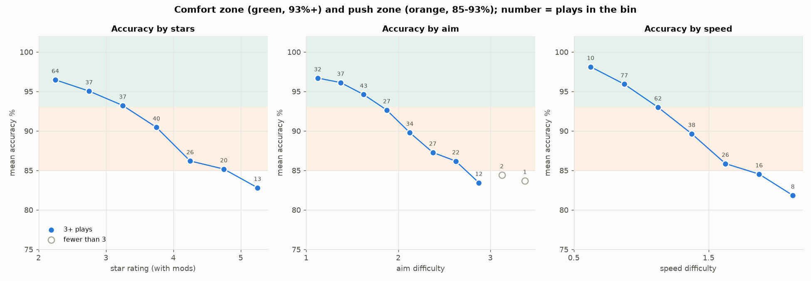
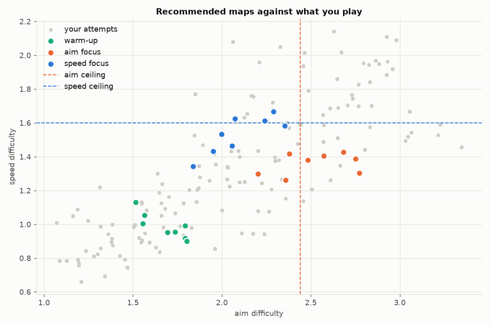

# osu-coach

vibecoded this because i wanted to know what im actually bad at in osu. started as one script that pulled my stats and then it kinda got out of hand

you give it your own osu api client, it looks at your plays, guesses whats holding you back and gives you maps + a practice session for next time. run it again after you play and it checks how the last plan went

its a hobby thing so stuff might be janky. not affiliated with osu or ppy



## try it without an account

need python 3.11+. this runs on a fake player so no keys needed

```bash
pip install -e .
python -m osu_coach demo
```

then look at `demo_output/osu_analysis/report.md` and `plan.md`

## use it on your own account

1. go to osu.ppy.sh → settings → oauth → new oauth application. any name, leave callback url blank
2. run setup and paste your client id, secret and username

   ```bash
   python -m osu_coach setup
   ```

   that saves to `.env` and `config.toml` in this folder. git ignores both so you wont push your keys by accident
3. after you play:

   ```bash
   python -m osu_coach run
   ```

heads up: the api only keeps your last 24 hours and max 100 attempts, so run it right after playing (or mid session if you play a lot). if you skip a day those plays are just gone. it needs like 60 logged attempts before the prediction stuff kicks in, and a few sessions before trends mean anything

## what you get

everything goes in `osu_analysis/`

- `plan.md` - your next session. timed blocks, actual maps, predicted acc, goals
- `practice_maps.md` - bigger map lists (warm-up, aim, speed, stretch, dt)
- `report.md` - all the stats and charts
- `history/` - snapshot of every run + every attempt it has ever seen

this is what the skill part looks like on the fake player:

| ceiling | value | 95% CI | meaning |
|---|---|---|---|
| aim | 2.44 | 2.35-2.55 | you average 3 misses per 100 objects here |
| speed | 1.60 | 1.57-1.63 | you average 15 100s/50s per 100 objects here |



## commands

| command | what it does |
|---|---|
| `setup` | saves your api client and username |
| `run` | pull, analyse, plan, snapshot. this is the one you want |
| `plan --minutes 30` | new plan from the last pull |
| `analyze` | just rebuild the report |
| `pull` | just download |
| `download` | queues the maps in osu!direct (stable + supporter only). `--test` does one map, `--list` just shows them |
| `demo` | the fake player |

`run --no-pull` skips the api. first plan takes a few minutes cause it has to look up every map's difficulty and the api wants about 1 request a second. its cached after that

## settings

copy `config.example.toml` to `config.toml` or let `setup` do it. you can change session length, where maps come from (genres, artists, searches), what to keep out of dt, stuff like that

## how it decides stuff

short version:

- **weaknesses** - tests about 15 things (aim, speed, ar, od, length, sliders, mods...) at equal difficulty. if something comes back empty it says so
- **predictions** - get tested on maps the model hasnt seen. if they cant beat just guessing your average the report tells you
- **maps** - picked by predicted acc, whether they hit the right skill, favourites, and not giving you the same artist 5 times
- **plans** - get reviewed next run. if you keep beating the predictions the next one gets harder, and the other way around

long version is in [docs/how-it-works.md](docs/how-it-works.md), its basically my notes

## stuff it cant do

- it only sees scores, not replays. no hit errors, no unstable rate, no "you miss on this pattern"
- star rating doesnt really get rhythm, so weird rhythm maps wont show up right
- the drills are just normal practice advice. the data picks which ones you see, it doesnt prove they work
- lazer submits restarts as fails so finish rates look really low there
- on pure noise about 1 in 8 scans still flags something, so dont trust one borderline result
- its all based on your own plays and thats not that many plays

## dev stuff

```bash
pip install -e ".[dev]"
pytest
ruff check .
```

## support

if this helped you and you feel like it: https://ko-fi.com/neook

## license

MIT
